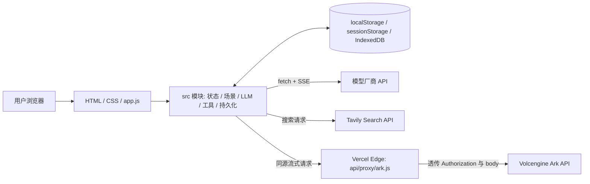

# MyAgentTeam 技术架构与维护指南

本文档描述当前代码实际采用的架构。应用是浏览器优先的静态 Web 项目，Agent 调度和状态管理运行在用户浏览器中。

## 系统边界

### 运行与隐私边界

- 没有自建应用服务器、账号系统或云端用户数据库。核心页面可由静态托管服务交付。
- Agent Prompt、场景调度、成本统计和大部分数据处理都在浏览器内运行。
- API Key 默认保存在浏览器本地配置中；可选启用 `src/persist/encryption.js` 的 PBKDF2 + AES-GCM 本地加密。
- OpenAI、Anthropic、Qwen、DeepSeek、Gemini 和 Tavily 请求由浏览器直接发往服务商。豆包 Ark 在部署环境中经 `api/proxy/ark.js` 转发，代理不实现编排，但网络请求确实经过托管平台。
- localStorage/sessionStorage 加密不能阻挡同源恶意 JavaScript 或 XSS。不要将其描述为端到端加密或服务器永远看不到请求。

## 代码布局

| 路径 | 职责 | 修改提示 |
|---|---|---|
| `index.html` | 页面结构、静态 UI、模块脚本加载顺序 | 新模块必须在依赖它的模块之前加载 |
| `styles.css` | 全局样式、响应式布局、组件样式 | 优先复用已有 CSS 变量和组件类 |
| `app.js` | 页面事件、应用启动和暂未拆出的协调逻辑 | 大改前确认是否可归入 `src/` 既有模块 |
| `src/lib/constants.js` | 存储键、超时、token/成本等常量 | 避免在多个模块重复定义边界值 |
| `src/lib/utils.js` | 共用纯工具函数 | 纯逻辑适合单元测试 |
| `src/lib/vendor.js` | 模型厂商和模型元数据 | 修改模型识别时检查自定义 model ID 的兜底行为 |
| `src/state/state.js` | 初始状态定义 | 新增持久化状态时同步检查 load/save 和迁移 |
| `src/state/store.js` | 项目空间及其记忆访问逻辑 | 项目级数据读写应遵守 active project 隔离 |
| `src/state/kb.js` | 知识库状态与相关行为 | 注意 IndexedDB 与应用状态同步 |
| `src/scenes/scene_config.js` | 场景和自定义团队配置 | 扩展内置场景优先用配置，而不是复制调度代码 |
| `src/scenes/agents.js` | Agent 角色定义和提示词 | 输出格式、工具权限和角色职责在此维护 |
| `src/scenes/orchestrator.js` | Agent 调度、工具循环、场景阶段、循环检测 | 变更时检查取消、超时、阶段转换和任务清理 |
| `src/llm/llm.js` | 模型厂商路由及 API 调用 | API Key 仅从运行时配置读取；不要把 Key 放入日志或 Prompt |
| `src/llm/stream.js` | SSE/厂商流式协议解析 | 兼容错误响应、流结束和取消信号 |
| `src/llm/simulated.js` | 无 Key 的模拟响应 | 保持模拟模式与主要 UI 流程可用 |
| `src/tools/tools.js` | date、web search、fetch、JS 等 Agent 工具 | 为外部请求设置超时、输入校验和输出截断 |
| `src/persist/storage.js` | localStorage 持久化函数 | 任何结构变更都应考虑旧数据迁移 |
| `src/persist/encryption.js` | Web Crypto 本地加密 | 修改格式时保留旧格式解密/迁移策略 |
| `src/persist/indexeddb.js` | IndexedDB 存储封装 | 调整 schema 时处理已有数据库版本 |
| `src/memory/learning.js` | 记忆更新、摘要和清理 | 校验跨项目隔离及长度上限 |
| `src/ui/` | 渲染、模型选择器、历史 UI | 保持 DOM 更新与持久化逻辑分离 |
| `src/i18n/` | 中文/英文语言资源 | 新增可见文案时两种语言都要补齐 |
| `api/proxy/ark.js` | Ark API 的同源 SSE 透传 | 公开端点；变更需关注来源校验、滥用、日志和响应头 |
| `tests/unit/` | Vitest 单元测试 | 关注 setup 是否按浏览器全局和依赖顺序加载模块 |
| `tests/e2e/` | Playwright UI 冒烟测试 | 对关键用户路径做回归 |

## 模块加载与运行时依赖

`src/` 模块并非 ES module。每个文件通过 IIFE 建立 `window.MAT_*` 全局命名空间，部分兼容性函数仍由 `app.js` 暴露为全局函数。页面脚本加载顺序是运行时依赖图的一部分。

当前大致顺序为：类型与常量/工具 → 状态 → 持久化 → 场景/LLM/工具 → UI → 编排/记忆/i18n → `app.js`。完整权威顺序以 `index.html` 的 script 标签为准。

添加模块时：

1. 选定单一职责和命名空间，例如 `window.MAT_FEATURE`。
2. 只通过清楚的导出对象暴露接口，避免添加更多无归属全局变量。
3. 在 `index.html` 按依赖先后插入脚本，并确认 cache-busting query 与其他本地脚本一致。
4. 若依赖 `state`、DOM 或其他模块，在文件头注释中说明。
5. 测试夹具也必须按相同依赖顺序加载；应用能运行不代表 Vitest 环境自动具备这些浏览器全局。

## 主要执行流程

1. `index.html` 加载依赖脚本，`app.js` 读取 localStorage/IndexedDB 并绑定事件。
2. 用户输入和当前选中场景送入路由/场景配置逻辑；不确定时由 UI 确认场景。
3. `launchTask` 在 `src/scenes/orchestrator.js` 选择相应编排方式，按 Agent、轮次或阶段调度。
4. Agent 通过 `src/llm/llm.js` 选择真实模型或模拟模式；`src/llm/stream.js` 解析 SSE 增量并交由 UI 展示。
5. 如 Agent 请求工具，`src/tools/tools.js` 执行并把经过截断/规范化的结果交回 Agent。
6. 任务状态、历史、记忆、成本等通过对应持久化模块保存至浏览器存储。

取消任务时应贯穿 AbortController 到模型和工具请求，并清理运行状态；多阶段流程还需保证单阶段失败后的用户状态明确。

## 数据与存储

- `localStorage`：配置、任务历史、累计数据、团队/场景配置及部分记忆。
- `sessionStorage`：加密会话派生密钥缓存等当前会话数据。
- IndexedDB：适合较大或结构化的知识库数据。
- 项目空间：记忆/历史中部分字段按 active project 分区；修改存储结构需检查迁移和删除项目时的清理。
- 加密格式：`ENC1` 前缀、随机 AES-GCM IV、PBKDF2 派生密钥。任何格式升级都需考虑已加密数据解锁、错误密码、禁用加密和遗留明文迁移。
- 浏览器数据不会自动同步到其他设备。用户清理站点数据会丢失本地记录，除非用户另行导出备份。

## LLM 与工具扩展

### 添加模型供应商

检查 `src/lib/vendor.js` 的供应商识别、`src/llm/llm.js` 的请求格式、`src/llm/stream.js` 的增量解析、`src/state/state.js` 的配置默认值、`index.html` 的设置 UI 和 `src/i18n/` 文案。还要处理错误响应、AbortSignal、模型 ID 自定义输入以及 usage 缺失时的 token 估算。

兼容 OpenAI Chat Completions 的模型可复用 `callOpenAI`，但需单独验证 endpoint、认证头、流式 chunk、工具调用和错误格式，不要仅凭兼容声明推定完全兼容。

### 添加工具

在 `src/tools/tools.js` 添加 schema 和执行器，确认只有预期 Agent/场景可见；对用户或模型提供的参数做验证；外部 I/O 设置 timeout/AbortSignal；截断大结果；错误信息不得泄露 API Key。联网工具需考虑供应商计费与隐私边界。

## 测试与质量状态

- 单元测试：`npm test` 或 `npm run test:unit`。
- 浏览器测试：`npm run test:e2e`；首次需 `npm run test:e2e:install` 安装 Chromium。
- 页面内 smoke runner：`?test=1`。
- Playwright 使用 `python -m http.server` 启动静态站点，执行测试前需确保 Python 可用或调整 `playwright.config.js`。
- 当前仓库的单测 setup 与模块化后的全局/导出约定存在不同步风险；本次检查中 `npm test` 结果为 5 项通过、71 项失败，错误集中于 `SCENE_RULES` 初始化时序、`SCENE_FLOWS`/Agent 配置未从测试环境导出等。不要把当前单测状态描述为全绿；维护时应先统一测试加载方式，再把它设为合并门槛。

## 已知维护事项

1. **单测夹具与浏览器 IIFE 模块不同步**：调整 `tests/setup.js`/`tests/setup.mjs`，明确加载哪些脚本和全局；优先将纯函数迁成可导入模块时再考虑 ES module 化，避免一次性重写整个应用。
2. **全局耦合仍存在**：`app.js` 保留不少协调逻辑，多个模块依赖 `state`、DOM 函数和互相导出的全局对象。新代码沿用边界清楚的模块 API，逐步迁移，不要把一次小功能变成大规模重构。
3. **Ark 代理面向公网**：约束方法、允许来源或速率策略前，应设计本地开发与部署域名的配置方式；不得把任意转发能力开放为通用代理。
4. **依赖与模型列表需要维护**：`package-lock.json` 锁定 npm 依赖；页面 CDN 资源和厂商模型 ID 独立于 npm lockfile，应显式评估升级与兼容性。
5. **文档需跟随实际实现**：设计档案是产品/方案记录，不是运行时代码的权威。功能是否已实现应以源码和自动化检查为准。

## 发布前检查建议

- 确认静态入口和所有脚本 URL 返回成功，生产域名使用 HTTPS。
- 在未配置 Key 的模拟模式走完关键场景。
- 至少验证一个 OpenAI 兼容模型、一个独立协议模型，以及 Ark 代理的 SSE、错误和取消行为。
- 检查公开代理来源/滥用控制，并确认托管平台不会记录 Authorization 或请求 body。
- 检查浏览器存储迁移、加密启停、错误密码和数据导出恢复。
- 确认 README、隐私说明和部署行为描述一致；当前没有 LICENSE 时不要宣称开源许可证。
